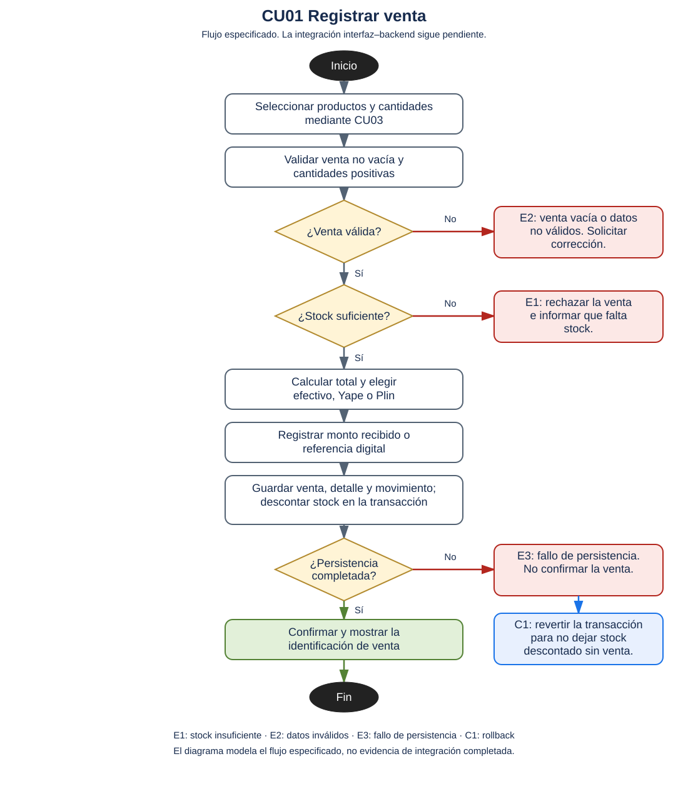

# Proceso crítico: CU01 Registrar venta

## Precondición

Humberto tiene una sesión administrativa activa. Los productos están activos y tienen precio y stock registrados.

## Flujo principal

1. Consultar el catálogo mediante CU03 y seleccionar productos y cantidades.
2. Validar que la venta no esté vacía, que las cantidades sean positivas y que exista stock suficiente.
3. Calcular el total y elegir efectivo, Yape o Plin.
4. En efectivo, registrar el monto recibido y calcular el vuelto cuando corresponda. En pago digital, guardar la referencia de operación del prototipo.
5. Guardar cabecera, detalle y movimiento de salida dentro de una transacción, y descontar el stock.
6. Confirmar la operación y mostrar el identificador de venta.

## Flujos alternos

- A1. Si el comprador se identifica como cliente registrado, vincularlo mediante CU02. La venta puede continuar sin una cuenta asociada.
- A2. Si el pago en efectivo supera el total, mostrar el vuelto. Para Yape o Plin, registrar la referencia de operación del prototipo.

## Excepciones y compensación

- E1. Si falta stock, informar qué producto no tiene cantidad suficiente y rechazar el intento actual. El usuario puede iniciar una nueva selección.
- E2. Si la venta está vacía o las cantidades no son válidas, solicitar la corrección.
- E3. Si falla la persistencia, no confirmar la venta.
- C1. Revertir la transacción para evitar que queden una venta parcial o existencias descontadas sin una venta confirmada.

## Integración

La interfaz confirma una venta local y no invoca la transacción disponible en el backend. El cálculo de descuentos de la interfaz tampoco coincide con el cálculo base del backend.

## Diagrama de actividad

Figura. Diagrama de actividad del caso de uso CU01: Registrar venta. Elaborado en diagrams.net (draw.io) a partir del flujo especificado en el proyecto.
