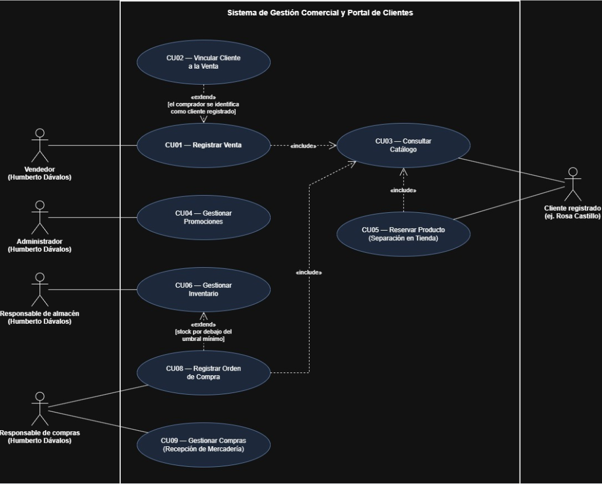

# SRS breve: Comercial Nazareth

Este documento especifica el comportamiento requerido y resume el estado técnico descrito en el informe de avance. Los estados técnicos no demuestran por sí solos que una función esté integrada: este repositorio no incluye el código fuente ni registros de ejecución para reproducir las pruebas.

## Requisitos funcionales

| ID | Requisito | Comportamiento requerido | CU | Estado técnico |
|---|---|---|---|---|
| RF-01 | Registrar venta | Registrar productos, cantidades y método de pago; calcular el total y conservar venta, detalle y salida de stock en una operación. | CU01 | Servicio transaccional disponible; la interfaz confirma la venta con datos locales y no invoca el servicio. |
| RF-02 | Consultar existencias y alertas | Mostrar el stock y señalar productos activos cuya cantidad sea menor o igual al umbral mínimo configurado. | CU06 | Consulta API disponible; la interfaz usa datos de ejemplo. |
| RF-03 | Identificar proveedor de la orden | Guardar razón social, RUC y teléfono del proveedor dentro de la orden, sin exigir un catálogo independiente. | CU08 | Especificado; no hay servicio de compras. |
| RF-04 | Registrar orden de compra | Conservar proveedor, productos, cantidades, costos y estado pendiente, recibida o anulada; calcular el total estimado. | CU08 | Especificado; sin implementación. |
| RF-05 | Registrar recepción | Registrar cantidades recibidas de una orden pendiente, aumentar el stock y crear movimientos de entrada en una transacción. | CU09 | Existe soporte parcial de inventario, sin servicio transaccional de recepción. |
| RF-06 | Acceder según perfil | Permitir inicio y cierre de sesión para el perfil administrativo y el cliente registrado. | Transversal | La sesión de demostración y la autenticación JWT están separadas. |
| RF-07 | Consultar catálogo | Buscar productos por nombre y categoría, mostrar precio y disponibilidad, y permitir favoritos y listas en el portal. | CU03 | Catálogo local y endpoint de consulta disponibles; las vistas no están integradas de extremo a extremo. |
| RF-08 | Gestionar promociones | Crear, editar, pausar, activar y eliminar campañas por producto, con descuento, vigencia y estado. | CU04 | CRUD local y endpoints separados, sin sincronización entre ambos. |
| RF-09 | Solicitar separación | Crear una solicitud con productos, importe estimado y código, conservando el estado de la solicitud. | CU05 | Solicitud local; no existe API de reservas y no se bloquea stock. |
| RF-10 | Vincular cliente a la venta | Asociar un cliente registrado cuando se identifique y permitir ventas sin cliente vinculado. | CU02 | La API admite customerId opcional; el selector de interfaz no está conectado. |
| RF-11 | Consultar clientes frecuentes | Mostrar nombre, contacto, frecuencia e historial básico de clientes identificados. | Consulta administrativa | Vista con datos de ejemplo; no hay ruta de clientes. |
| RF-12 | Consultar resumen y reportes | Mostrar ventas, métodos de pago y productos con movimiento por periodo. | Consulta administrativa | Resumen API parcial; los reportes de interfaz usan datos de ejemplo. |
| RF-13 | Administrar accesos | Registrar, editar y desactivar cuentas con rol autorizado y proteger la cuenta administrativa. | Transversal | Gestión local y endpoints separados, sin sincronización. |
| RF-14 | Consultar cuenta y beneficios | Mostrar al cliente registrado sus datos, historial de compras y puntos asociados a su cuenta. | Portal de clientes | Vista de referencia con historial y puntos predeterminados. |
| RF-15 | Mantener productos e inventario | Registrar y actualizar productos, precios y stock inicial; permitir ajustes autorizados sin perder el historial. | CU06 | Formulario visual y tabla products disponibles; el guardado y los ajustes no están integrados. |

## Casos de uso

| ID | Nombre | Actor | Requisitos relacionados |
|---|---|---|---|
| CU01 | Registrar venta | Vendedor | RF-01, RF-07, RF-10 |
| CU02 | Vincular cliente a la venta | Vendedor, dentro de CU01 | RF-10 |
| CU03 | Consultar catálogo | Cliente registrado, Vendedor y Responsable de compras | RF-07 |
| CU04 | Gestionar promociones | Administrador | RF-08 |
| CU05 | Reservar producto (Separación en tienda) | Cliente registrado | RF-09 |
| CU06 | Gestionar inventario | Responsable de almacén | RF-02, RF-15 |
| CU08 | Registrar orden de compra | Responsable de compras | RF-03, RF-04, RF-07 |
| CU09 | Gestionar compras (Recepción de mercadería) | Responsable de compras | RF-05 |

CU01 incluye CU03. CU02 extiende CU01 cuando el comprador se identifica como cliente registrado. CU05 y CU08 incluyen CU03. CU08 extiende CU06 cuando el stock está por debajo del mínimo y Humberto decide reponer. La recepción requiere una orden pendiente.

## Requisitos no funcionales

| ID | Requisito | Criterio de aceptación |
|---|---|---|
| RNF-01 | Rapidez de registro | Una venta de hasta tres líneas, con precios cargados y un administrador, se confirma en menos de 15 segundos, sin contar la espera de un pago externo. |
| RNF-02 | Separación de perfiles | Las opciones administrativas quedan fuera de la navegación del cliente y las operaciones protegidas rechazan roles no autorizados. |
| RNF-03 | Tiempo de consulta | Productos, stock y resumen responden en tres segundos o menos, con un usuario concurrente y el catálogo de demostración en entorno local. |
| RNF-04 | Integridad de venta | Venta, detalle y movimiento se confirman juntos; ante un error no quedan modificaciones parciales. |
| RNF-05 | Consistencia monetaria | Totales y subtotales usan dos decimales, con diferencia admitida de S/ 0,00 respecto del cálculo redondeado. |
| RNF-06 | Respaldo recuperable | Conservar una copia de la base de datos al cierre de cada jornada y comprobar su restauración con las ventas incluidas. |

## Reglas del negocio

- RB-01: Yape y Plin se registran como método de pago. El código de operación no confirma el pago bancario.
- RB-02: la venta usa el precio consultado por el servicio y redondea a dos decimales. El cálculo de descuentos debe coincidir entre interfaz y backend.
- RB-03: una venta puede registrarse sin cliente asociado.
- RB-04: una orden de compra no aumenta el stock. El incremento ocurre al confirmar la recepción.
- RB-05: una solicitud de separación no confirma una venta ni garantiza el bloqueo de existencias.
- RB-06: la alerta muestra stock menor o igual al mínimo. CU08 puede extender CU06 cuando el stock está por debajo del mínimo y Humberto decide reponer. Si el stock equivale al mínimo, se muestra la alerta, pero esa condición por sí sola no activa CU08.
- RB-07: los datos del proveedor se guardan en la orden. El proveedor no tiene credenciales ni un caso de uso independiente.
- RB-08: una recepción parcial mantiene pendiente la orden y acumula cantidades recibidas. Se rechazan referencias duplicadas y cantidades superiores al saldo por recibir.

## Trazabilidad y evidencia

La [matriz de trazabilidad](matriz-trazabilidad.md) relaciona requisitos, historias de usuario, casos de uso, artefactos y comprobaciones definidas en el informe. Los identificadores PR-01 a PR-19 corresponden a comprobaciones propuestas, no a pull requests de GitHub.

Las comprobaciones PR-01 a PR-19 son criterios de verificación propuestos, no pull requests de GitHub. El informe de avance describe el estado técnico y las pruebas de backend, pero este repositorio no incluye el código fuente ni los registros de ejecución necesarios para reproducir esos resultados. Las tablas documentan requisitos y comprobaciones; no atribuyen a esta línea base pruebas ejecutadas.
